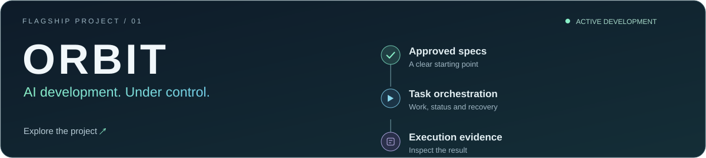

  

  <a href="mailto:aviork9@gmail.com"><b>Email ↗</b></a> &nbsp; · &nbsp;
  <a href="https://www.linkedin.com/in/avior-kasay-60360b280"><b>LinkedIn ↗</b></a> &nbsp; · &nbsp;
  <a href="https://github.com/AviorLab/orbit-showcase"><b>Explore ORBIT ↗</b></a>
   
  Northern Israel · Open to remote collaboration · Hebrew / English

### Welcome to my build space 👋🏾

I build business automations, API integrations and AI workflows. My background spans software development and QA — I care about clear requirements, reliable execution and checking what actually happened.

### Featured build

**ORBIT** brings project specs, approvals, task queues and execution evidence into one control room. My flagship project, under active development.

[**Explore the public showcase →**](https://github.com/AviorLab/orbit-showcase)

### More from the lab

| 🧪 Test automation | ⚙️ Backend development |
| :--- | :--- |
| [**AviorLab Selenium →**](https://github.com/AviorLab/AviorLab-selenium) | [**Node.js API →**](https://github.com/AviorLab/project-nodeJs) |
| Java-based browser test automation. | Server-side application with user and card APIs. |

[Browse all repositories ↗](https://github.com/AviorLab?tab=repositories)

### On my workbench

| Automation & integration | Code & delivery |
| :--- | :--- |
| Make · n8n · monday.com | Python · JavaScript · SQL |
| REST APIs · Webhooks · CRM workflows | Git · Docker · CI/CD |
| AI agents · Reusable skills · Workflow design | QA · Java · Selenium |

Understand the process. Build it simply. Verify the result.

